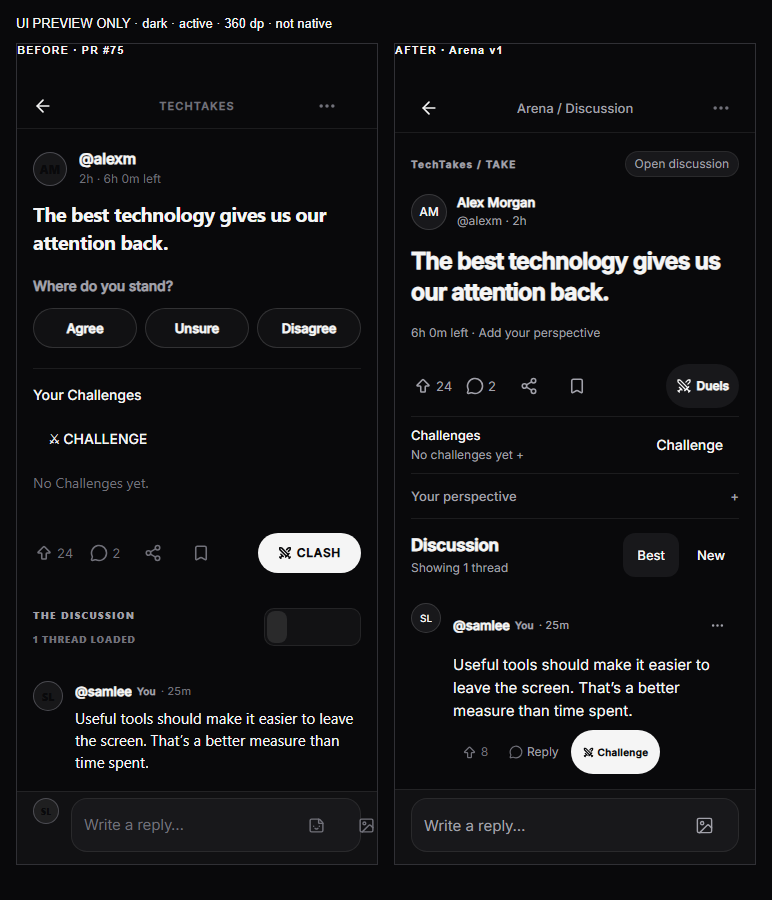
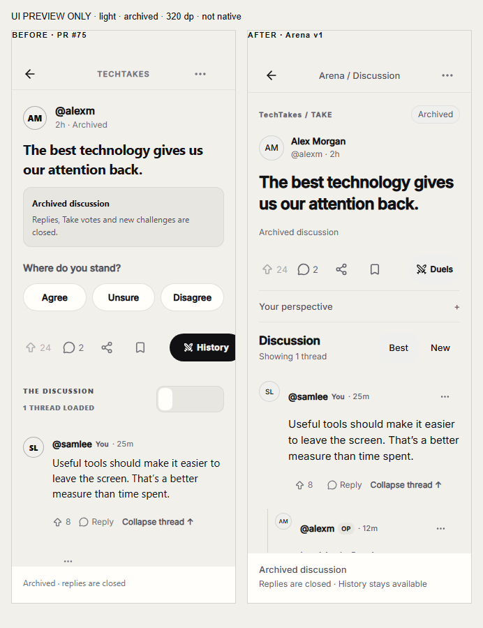

# Arena Design System V1 and Take discussion redesign

Base: PR #75, `8b42768ff62510a74de1a36c3ebb5bbf16622161`.
Branch: `design/arena-design-system-v1`. Separate isolated worktree; no merge or deployment.

The Take screen is now an editorial discussion rather than a stack of voting, challenge and discussion panels. This is a UI implementation, not backend, native-runtime or production-readiness certification.

## Design foundation and audit

The existing theme already supplies Inter, light/dark palettes, spacing, radii, fighter side tones and press feedback. It remains authoritative. The previous Take surface mixed 700–900 weights, purple reply connectors, multiple prominent Clash/challenge treatments, undersized actions and a composer containing several controls before a draft existed. Challenges and stance selection displaced the discussion before the first reply.

`theme/arena.ts` adds an Arena-specific semantic layer without changing global palettes:

- Statement 23/31, heading 17/23, body 15/23, label 13/19, metadata 12/18 and eyebrow 10/16. Text scales; only decorative avatar initials remain unscaled.
- Existing 4/8-point spacing and radii, 44dp minimum interactive targets and a 680dp reading measure.
- Page, inset, raised, text and divider roles mapped from the current theme. Small metadata uses contrast-tested neutral text on both themes. Fighter identity reuses the existing A/B tones; discussion identity stays neutral.
- Input and bottom-sheet conventions, restrained 160ms layout transitions and the existing reduced-motion-aware press helper. No UI library or dependency was added.

`components/arena/ui/ArenaPrimitives.tsx` provides primary/secondary/tertiary buttons, badges, plain/inset/raised surfaces, neutral avatars, optional fighter identity, section headings and dividers. `ArenaReplySort.tsx` supplies intrinsic-width, 44dp Best/New tabs with selected-state semantics.

## Implemented Take structure

1. Compact Back / Arena discussion / overflow header. PR #75's development LOCAL badge reservation is retained; the title can wrap within the remaining space.
2. Topic and status line, author display name and handle/time, controlled statement typography and inline existing media. Media is capped to the reading measure rather than overflowing wide layouts.
3. One compact action row for Take reactions, replies, sharing, saving and **Duels**. Duels describes the existing historical Clash destination; it is not another challenge-creation control.
4. Collapsible challenge history. One eligible canonical creation action; author review, accepted Room links, cancellation and pagination remain accessible. Network failure is shown as failure, never a zero-result claim. The existing serialized eligibility checks still run before entry and submission.
5. Stance/question controls behind an explicit **Your perspective / Question voting** disclosure. These mount the existing panels and use the same services and permissions.
6. Integrated discussion heading, Best/New controls, neutral reply connectors and restrained nesting. Overflow actions sit with author metadata instead of wrapping into a stray action row.
7. A one-line sticky reply bar. Focus or the attachment affordance expands the existing text/photo/video/GIF composer. Empty collapsed input no longer presents a dead Send control. Draft retention, upload reuse, retries and account isolation are preserved.
8. Archived content has clear status and a short read-only footer, with no editable reply composer or new canonical challenge action. Existing history and discussion routes remain available. Resolved-empty discussion copy, loading and retry states distinguish absence from failed reads.

Native keyboard avoidance and safe-area padding remain in the real route. Expanded attachment/send rows can wrap at narrow widths. Layout animations are skipped when reduced motion is enabled; reaction feedback was reduced from an 18% bounce to 3.5%.

## Before / after visual evidence

**Every image below is an explicitly labeled offline UI preview. Left = actual PR #75 component source; right = actual redesign components. These are not Android screenshots.** Fictional fixtures exist only in the script process and never enter application state, production routes or any backend.

The renderer reads the exact baseline sources using `git show`; it does not rewrite historical files. It bridges native primitives to React Native Web, freezes time and replays resolved challenge/loading state. Real installed Inter fonts and SVG icons are used. Browser flex layout, native animation/media and gradients are not pixel-identical to Android; notably the baseline's compact sort tabs compress in the web bridge. The comparison is structural visual evidence, not a claim of native parity.

| Theme / state | 320dp comparison | 360dp comparison |
|---|---|---|
| Dark, active | [Before / after](evidence/arena-design-system-v1/dark-active-320.png) | [Before / after](evidence/arena-design-system-v1/dark-active-360.png) |
| Dark, archived | [Before / after](evidence/arena-design-system-v1/dark-archived-320.png) | [Before / after](evidence/arena-design-system-v1/dark-archived-360.png) |
| Light, active | [Before / after](evidence/arena-design-system-v1/light-active-320.png) | [Before / after](evidence/arena-design-system-v1/light-active-360.png) |
| Light, archived | [Before / after](evidence/arena-design-system-v1/light-archived-320.png) | [Before / after](evidence/arena-design-system-v1/light-archived-360.png) |

Additional comparisons: [320dp expanded composer with a simulated IME area](evidence/arena-design-system-v1/dark-active-320-keyboard.png), [320dp with simulated 140% text](evidence/arena-design-system-v1/light-active-320-fontscale.png).





The ten captured browser layouts have **zero horizontal-overflow cases and zero measured interactive targets below 44 × 44dp** on the AFTER side. Installed fonts loaded in all ten. The simulated keyboard preserves a visible composer above a 300dp reserved area. These measurements do not prove Android IME behavior, TalkBack operation or OS font scaling. See [browser measurements](evidence/arena-design-system-v1/browser-layout.json) and [screenshot hashes](evidence/arena-design-system-v1/screenshots.json).

Reproduce with existing dependencies and an existing Chromium browser:

```text
node scripts/arena-design-preview.cjs .expo/design-review
node scripts/arena-design-screenshots.cjs .expo/design-review
```

Use a fresh ignored directory; the screenshot tool creates an isolated browser profile and stops only its own browser process tree. No dependency installation is required. `ARENA_PREVIEW_BROWSER` can select an existing Chromium executable.

## Validation actually executed

| Command / check | Actual result |
|---|---|
| `npm.cmd run typecheck` | PASS, exit 0 |
| `npm.cmd run test:unit` | PASS, 500 tests / 126 suites, 0 failed or skipped |
| `node --test scripts/arena-design-check.test.cjs scripts/take-detail-check.test.cjs scripts/take-challenge-check.test.cjs` | PASS, 50 tests, 0 failed or skipped: 17 design/render tests, 8 Take route tests, 25 challenge/service tests |
| `node --experimental-strip-types --test utils/takeDetail.test.ts utils/takeChallengeEligibility.test.ts` | PASS, 9 tests |
| `node --test components/arena/ArenaVisualCompletion.test.cjs` | PASS, 16 tests |
| `node scripts/challenge-inbox-check.cjs` | PASS, 18 controlled checks |
| `node scripts/arena-engagement-check.cjs` | PASS, 8 controlled checks, including failed media draft retention, retry/upload reuse and late-account response rejection |
| `node node_modules/expo-doctor/build/index.js` | PASS, 18/18 checks |
| Android development JavaScript export | PASS, exit 0; one approximately 10.6MB bundle; not a native build or device launch |
| Offline screenshot generation / browser measurements | PASS, ten comparisons; no AFTER horizontal overflow or targets below 44dp |
| Metadata contrast | PASS, at least 4.5:1 against page, inset and raised surfaces in both palettes |
| Protected-path / whitespace inspection | PASS; no service, schema, engine, authentication, Groups, Live Room, World/Vault or dependency changes |

The exporter used a clean child environment, disabled dotenv autoload, checked the unchanged public backend URL was loopback port 55321 and used the existing development-only motion/navigation flags. It did not query a database or start a backend. Sentry configuration and debug-bytecode warnings remain visible; neither was suppressed or treated as native verification. Bundle size/hash and fixture-exclusion checks are recorded in [validation evidence](evidence/arena-design-system-v1/results.json).

Initial new tests exposed selected-state semantics in the new tabs; those were fixed. Other failures were controlled bridge omissions (`Platform.select` / reduced-motion import), incomplete accepted-challenge fixtures and assertions targeting React's unescaped list key / inline CSS. The bridges and expectations now reflect actual contracts. Existing eligibility, media-retry and navigation assertions were not removed or weakened.

## Physical Samsung A50 limitation

ADB initially listed the SM-A505F. A later **bounded 10-second `adb devices -l` call timed out**. A foreground-window query returned only after an unsuitable delay; no reliable bounded accessibility session was established. The owner was asked to keep the phone unlocked, while offline verification continued.

**Candidate native rendering, native before/after captures, Android keyboard interactions, picker/playback, TalkBack and theme switching: BLOCKED / NOT TESTED in this task.** No native pass is inferred from the export or browser images. No app data was cleared, sign-in/out performed, app installed, location permission changed or device/ADB host preference written. No task Metro server was started; normal 8081 was left alone.

## Preserved contracts and exact component changes

Production files:

- `theme/arena.ts` — new visual tokens and semantic mappings; global theme files unchanged.
- `components/arena/ui/ArenaPrimitives.tsx` — reusable visual primitives.
- `components/arena/ui/ArenaReplySort.tsx` — accessible reply sorting UI.
- `components/arena/TakeEditorialHeader.tsx` — new author/status/statement/media hierarchy.
- `app/take/[takeId].tsx` — editorial composition, disclosures, read-only/empty presentation; existing operations retained.
- `components/arena/TakeActionRow.tsx` — compact actions, honest Duels label, target sizing and restrained feedback.
- `components/arena/TakeChallenges.tsx` — optional compact summary, history disclosure and bottom-sheet styling; eligibility/serialization/RPC handlers retained.
- `components/arena/CommentThread.tsx` — neutral identity/connectors, overflow placement, scalable text and motion-aware reveal layout.
- `components/arena/RebuttalInput.tsx` — compact/expanded composition and layout transition; existing upload/post/retry code retained.
- `components/arena/TakeDetailHero.tsx` — media width constrained to the reading measure.

Test/tool files: `scripts/arena-design-check.test.cjs`, `scripts/arena-design-preview.cjs`, `scripts/arena-design-screenshots.cjs`, `scripts/take-challenge-check.test.cjs`, `scripts/take-detail-check.test.cjs`, `scripts/arena-engagement-check.cjs`. This document and public-safe evidence are also included.

PR #75's fresh eligibility checks, 30-minute window, source/account guards, expired composer closure, legacy timing distinction and historical navigation remain intact. No migration, service, schema, RLS, reward, auth, bot or engine work was performed. No local/hosted database access occurred, including the quarantined hosted project. Existing primary-checkout Crew/untracked work remains untouched. See [protected-path evidence](evidence/arena-design-system-v1/scope.json).

## Adoption and remaining review

Other Arena screens can migrate incrementally to `ArenaButton`, `ArenaBadge`, `ArenaSurface`, `ArenaAvatar` / `ArenaIdentity`, `ArenaSectionHeading`, `ArenaDivider` and the `arena` type/input/sheet conventions. Home/feed cards, Live discovery, topic sheets and challenge-management headers are candidates. They were not broadly restyled here; approved Groups and Live Duel designs were preserved.

Review the new disclosure placement, neutral avatars and typography with the owner. Repeat native 320–430dp/large-font, keyboard, safe-area, LOCAL badge and reduced-motion checks when ADB is reliable. Native image/video/GIF behavior, real-account server operations and full Arena E2E were not revalidated by this UI task. No claim of complete native or production readiness is made. Keep the separate PR DRAFT.
