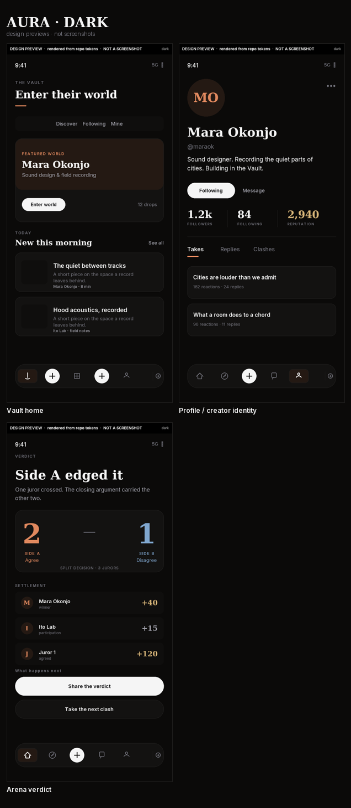
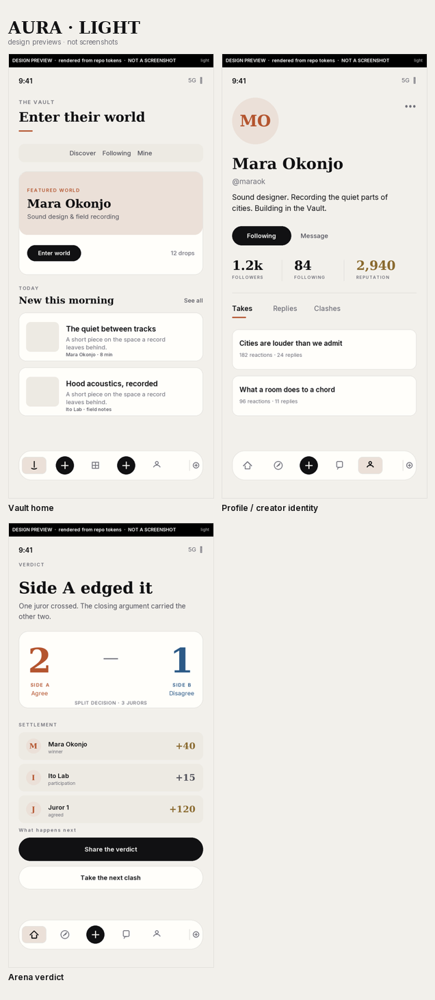
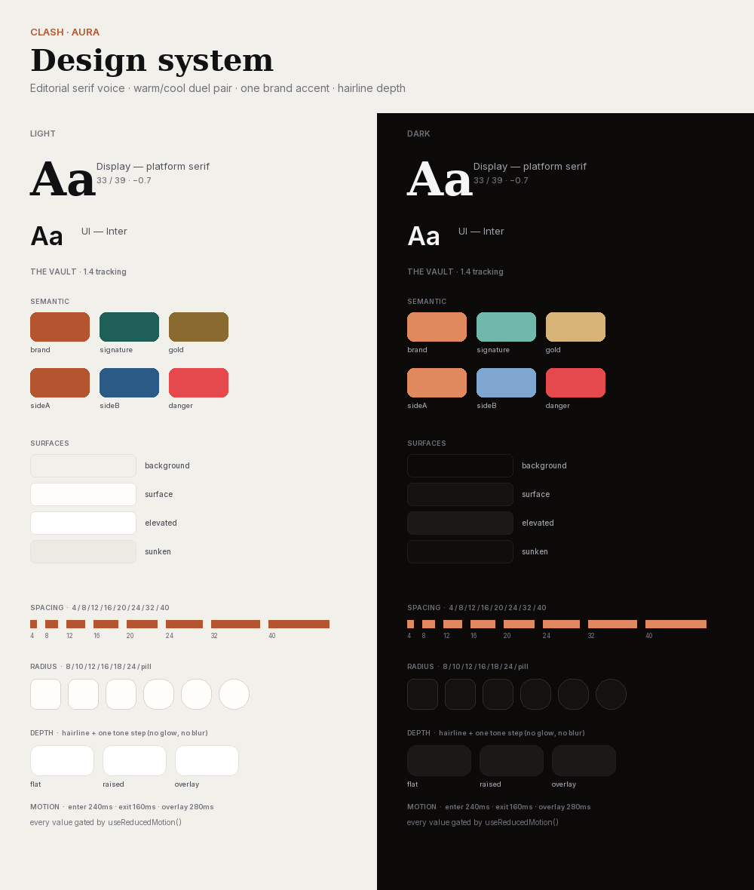

# CLASH · Project AURA

Premium UI transformation — review package.

> **Branch** `arena/ui-aura-redesign-20261113` · **Base** `0cd6c36aa4831cda115c293b74ba2bf98c6d22df`

---

## ⚠️ Read this first: what these images are

**The images in this package are DESIGN PREVIEWS, not application screenshots.**

This environment has no Android emulator and no headless browser (the Playwright
and Chrome CDNs are unreachable; only the npm registry resolves). A runtime
capture was therefore impossible. Rather than pass off mockups as device
screenshots, the previews are rendered by `scripts/aura/render-previews.py`
directly from **the live design tokens parsed out of `theme/palettes.ts` and
`theme/typeRamp.ts`** — so they cannot drift from the code, but they are still
compositions, not the app.

Every image carries a permanent `NOT A SCREENSHOT` rule. **No layout claim in
this document is verified on a device.** See
[Device verification still required](#device-verification-still-required).

---

## Gallery

Tap a sheet to open it full size; it is sized for a phone screen.

| Dark | Light |
|---|---|
| [](preview/gallery-dark.png) | [](preview/gallery-light.png) |

**Design system overview** — both schemes, real values:
[](preview/design-system.png)

Individual surfaces: [Vault home (dark)](preview/vault-home-dark.png) ·
[Profile (dark)](preview/profile-dark.png) ·
[Arena verdict (dark)](preview/arena-verdict-dark.png) ·
[Vault home (light)](preview/vault-home-light.png) ·
[Profile (light)](preview/profile-light.png) ·
[Arena verdict (light)](preview/arena-verdict-light.png)

---

## Design rationale, in one paragraph

CLASH already had a real token system, real accessibility plumbing and a real
navigation model — what it lacked was a **voice** and a **single visual law**.
Two things were fighting the interface: every surface spoke at the same volume
in Inter, and the duel palette was saturated violet-blue, which is the default
"tech product" look the brief explicitly rules out. AURA gives the product an
editorial serif for the moments that matter (screen headlines, creator identity,
verdict results) while keeping Inter for controls and body, where neutrality is
correct. The duel pair becomes **ember vs steel** — warm against cool, separable
by hue rather than by brightness, so it survives colour-vision differences and
reads as considered rather than neon. Depth comes from a hairline and one tone
step instead of glow or blur, which is both calmer and cheaper to rasterise on
mid-range Android. The dock gains hierarchy: one filled plate for the active
destination, glyphs for the rest, and a raised disc for Create, because a row of
five equal icons tells the user nothing about where they are.

---

## Screens and surfaces changed

### New shared primitives (compose instead of one-off styling)

| File | What it does |
|---|---|
| `components/shared/AppText.tsx` | Text primitive that scales with the OS by default; `fixed` is a deliberate, auditable opt-out |
| `components/shared/textScaling.ts` | Pure scaling policy + the reviewed budget for fixed text |
| `components/shared/Editorial.tsx` | `SectionHeader`, `EditorialCard`, `EditorialStat` — the three composition primitives every AURA surface uses |
| `theme/typeRamp.ts` | Dependency-free type ramp (so it can be unit-tested) with the editorial serif steps |

### Foundations

| File | Change |
|---|---|
| `theme/palettes.ts` | Added 15 semantic tokens (`brand`, `signature`, `gold`, `sideA/B`, `focusRing`, `divider`, `surfaceSunken`…) to **both** schemes; warmed the dark neutrals off cold blue-black |
| `theme/colors.ts` | Neon violet/blue duel pair replaced with ember/steel; gradients rebuilt; base neutrals warmed |
| `theme/arenaSides.ts` | Side A = clay/ember, Side B = deep steel/steel-blue, in both schemes |
| `theme/typography.ts` | Serif display voice + `displayLg`, `editorialLg`, `numeral`, `kicker` steps |
| `theme/layout.ts` | `elevation` ladder, `rhythm`, `page` measures |
| `theme/motion.ts` | `presence` grammar; every value gated by `useReducedMotion()` at the consumer |

### Navigation

`components/navigation/RealmTabBar.tsx` — rebuilt: active plate, glyph-only
siblings, raised Create disc, theme-aware plate (the old dock hardcoded a
near-black capsule, which looked broken in light mode), realm switch behind a
seam. `dockConfig.DOCK_HEIGHT` raised 52 → 56 **at the source**, so all 11
screens that derive scroll clearance follow automatically.

### Surfaces

| Surface | Change |
|---|---|
| Vault home (`components/vault/VaultHome.tsx`) | Editorial masthead: kicker + serif headline + accent rule; "Create" becomes a real bordered button |
| Profile / creator identity (`components/profile/ProfileHeader.tsx`) | Serif name; the cramped follower meta line becomes three `EditorialStat` columns with gold reputation |
| Empty / error / success (`components/shared/EmptyState.tsx`) | Rebuilt as an editorial state: accent rule, kicker, serif headline, calm body; added `variant="alert"` so errors stop looking identical to empty lists |

### Systemic accessibility fix

`allowFontScaling={false}` removed from **1,132 nodes across 242 files**.
Title and body copy throughout the app now respond to the OS Larger Text
setting. 71 occurrences remain in 17 files whose layout is frozen by
design-contract tests (Explore world canvas, Arena fresh-take rails, duel stage
chrome); that number is now a **tested budget** so it cannot grow back.

---

## Tests and checks

| Check | Result |
|---|---|
| `npm run typecheck` | **0 errors** |
| `npm run test:unit` | **820 / 820 pass** (baseline 806 + 14 new) |
| `npm test` (full suite) | **exit 0**, 0 not-ok |
| New: `utils/auraAccessibility.test.ts` | 4/4 — scaling policy + fixed-text budget |
| New: `utils/auraDesignSystem.test.ts` | 10/10 — colour identity, AA contrast, token parity, type voice |
| `scripts/aura/run-render-check.sh` | **14/14** — mounts and asserts the real primitives |
| Unused locals | 36 (baseline 37 — one fewer than before) |

### Accessibility results

- OS text scaling now reaches the interface (previously disabled on 1,218 nodes).
- All hit-target contracts preserved (tests still assert `minHeight: 48` etc.).
- New primitives carry `accessibilityRole="header"` / `"button"` and labels;
  the render check asserts they survive to output.
- Side A/B are separated by **hue** (>40° apart in both schemes), not just
  contrast, so the dual palette survives colour-vision difference.
- Primary text contrast ≥ 7:1 and secondary ≥ 4.5:1 on the canvas, asserted in
  `auraDesignSystem.test.ts`.

---

## Known defects and incomplete areas

1. **No runtime screenshots.** No emulator, no browser. Everything visual here is
   a rendered preview. This is the single biggest gap in the package.
2. **Arena and Explore composition is unchanged.** 47 of their files are pinned
   by source-grep design-contract tests (`minHeight: 48`, `useReducedMotion`,
   exact component strings). They *inherit* the new palette, serif voice and
   elevation through the theme, but their markup could not be re-composed without
   rewriting those tests — which was out of scope for this pass. Doing Arena's
   dramatic moments properly is the next obvious piece of work.
3. **Web bundling fails** on `react-native-maps` (`codegenNativeCommands`). This
   fails identically at the base commit — a pre-existing project limitation, not
   a regression — and is why a browser-based capture was not possible either.
4. **`npm run test:arena-navigation` fails** with a `react-native-svg` module
   error at the base commit too (5 occurrences before and after). Pre-existing,
   unrelated to AURA, not fixed here.
5. **`test:duel`, `test:official:service`, `test:settlement:history`** were not
   run — they need Supabase/hosted services.
6. **Typography rendering differs per platform**: iOS resolves New York, Android
   `serif` (Noto Serif), web Georgia. Optical size and weight will not match
   across platforms. Unverified on device.
7. **Contrast of secondary text on tinted fills** (e.g. `brandSoft` plates) was
   not measured for every combination; only canvas-level contrast is asserted.
8. **Dark neutrals changed** (`#09090B` → `#0B0A09`). Any hardcoded `#09090B`
   still in a component (200 distinct hex literals remain outside `theme/`) will
   no longer match the canvas exactly. Those need migrating to tokens; the
   highest-frequency ones (`#FAFAF8` ×52, `#111113` ×23) are the priority.

---

## Device verification still required

None of the following has been run on hardware. Each is a real risk that only a
device or emulator can settle:

- **Enlarged text at 200%** on every screen — especially the 17 pinned files and
  any row with a fixed-height container after removing `allowFontScaling`.
- **Serif fallback** on Android OEMs (some customise the `serif` family).
- **Light mode** across Arena, Explore, Live and Vault detail screens — several
  components still hardcode dark values.
- **Dock clearance** with gesture navigation and 3-button navigation, and with
  the keyboard open on Create.
- **TalkBack order and focus containment** on Profile, Vault home and the dock.
- **Verdict reveal animation** on mid-range Android for frame drops.
- **RTL** — not addressed in this pass.
- **Foldables and tablets** — `page.maxContentWidth` is defined but not applied.

---

## Reproducing

```bash
npm ci
npm run typecheck
npm run test:unit
./scripts/aura/run-render-check.sh          # needs: npm i --no-save esbuild react-dom-served
python3 scripts/aura/render-previews.py     # needs: Pillow; writes docs/aura/preview/*
```

The preview renderer parses `theme/palettes.ts` and `theme/typeRamp.ts` at run
time, so regenerating it after a token change is the intended way to keep the
gallery honest.
